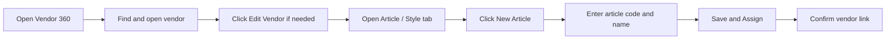

# 2. Article Registration

## Goal

Create an Article / Style record and link it to the correct vendor. An article describes a design or style; it is not the final size-and-colour stock item.

## Steps

1. Open **Vendor 360 Workspace** and search for the correct vendor.
2. Open the vendor record. Check the vendor code before continuing.
3. If the article area says **Read-Only**, click **Edit Vendor** if that control is available and your role allows editing.
4. Open the **Article / Style** tab.
5. Click **+ New Article**.
6. Enter the approved **Article / Style Code**. This is required. Do not invent a code or reuse another article's code.
7. Enter the article name or description so staff can recognize the design.
8. Check the vendor name shown in the form. It must be the vendor that owns or supplies this style.
9. Click **Save & Assign**.
10. Confirm that the new article appears in the vendor's assigned article list.

## Important

- Do not create a second article if the same design already exists. Search the code and name first.
- A size or colour variant is set up in Item Master, not by making a duplicate article for each size.
- If **New Article** is missing or the form is read-only, stop and ask the trainer to check your role and vendor edit access.

## Practice Task

Open the assigned practice vendor, find its article list, and identify one article code. If the trainer assigns a new practice article, register it once and confirm it is linked to that vendor.