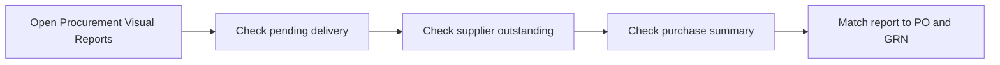

# 6. Reports and Printouts

## Goal

Check that the PO and GRN are recorded correctly, then preview and print the correct documents.

## A. Check Procurement Reports

1. Open **Procurement Visual Reports** from the Launchpad. This tile is listed for `MANAGER` and `SYSADMIN` users.
2. Open **Pending Delivery**. Search for the PO number or supplier. Check the open quantity.
3. Open **Supplier Outstanding**. Check the supplier and outstanding amount.
4. Open **Purchase Summary Register**. Review the PO count, GRN count, ordered amount, and received amount.
5. Compare the report with the PO and GRN numbers from your practice.
6. If the report has no rows, check the selected company/date range and confirm that a PO or GRN was actually saved.

## B. Preview and Print a Purchase Order

1. Open the PO in Purchase Studio.
2. Click **Preview (F9)** or **Print PO**.
3. Check vendor, delivery address, PO number/date, item names/codes, quantities, rate, tax, total, and terms.
4. Click **Print** or press F9/Ctrl+P. In the browser print window, choose the approved printer or **Save as PDF**. Continue only after the trainer checks the preview.

## C. Print a GRN

1. Open the GRN record or use the success/receipt action after posting.
2. In the success window, click **Print Statutory A4 Slip**. Use **View GRN History** to find a GRN that was posted earlier.
3. Check GRN number, vendor, linked PO, warehouse, item lines, received/damaged/accepted quantities, and costs.
4. Print only when the preview is correct. In the browser print window, select the approved printer or **Save as PDF**.

## Check Before You Finish

- The report shows the right supplier and document numbers.
- The PO is not shown as fully received if there is still an open balance.
- The GRN and printout show the actual receipt quantities.
- The printed document is readable and has no missing item lines or totals.

## Practice Task

Find the practice PO in Pending Delivery, compare it with the posted practice GRN, then preview both documents. Tell the trainer what changed after the GRN was posted.