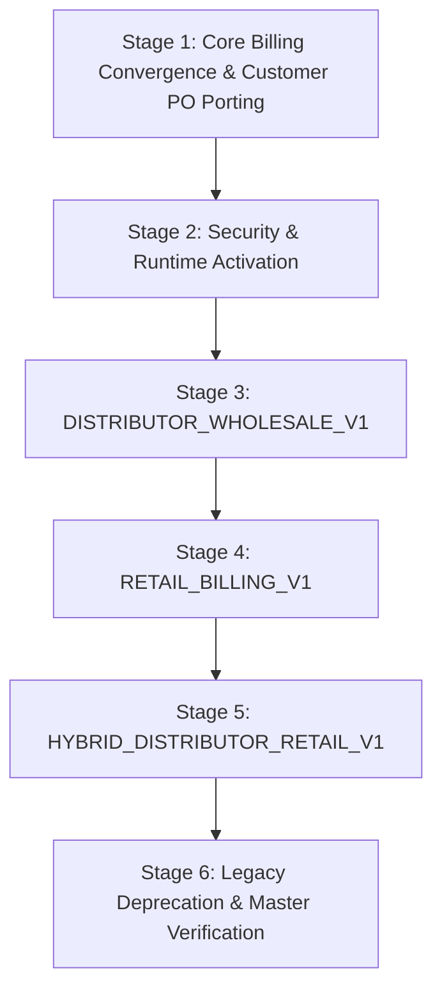

<!--
  Project      : SMRITI Retail OS
  Author       : Jawahar Ramkripal Mallah
  Designation  : Chief Systems Architect & Creator
  Email        : support@smritibooks.com
  Websites     : smritibooks.com | erpnbook.com | aitdl.com
  Version      : 3.17.0
  Created      : 2026-10-23
  Modified     : 2026-10-23
  Copyright    : © SMRITIBooks.com. All Rights Reserved.
  License      : Proprietary Commercial Software
  Classification: Architecture & Implementation Blueprint
-->

# SMRITI Retail OS — Template Implementation Sequence & Governed Core Specification
**Environment:** Development (`F:\SMRITRretailNX`)  
**Branch:** `smritiNX` | **Commit HEAD:** `a2d9bcff`  
**Governing Lead:** Jawahar Ramkripal Mallah, Chief Systems Architect & Creator  
**Status:** Approved for Phased Execution (Conditional Go)

---

## 1. Executive Blueprint & Sequential Rationale

SMRITI Retail OS delivers one unified, governed retail operating system capable of provisioning three distinct business archetypes without branching code or duplicating transactional engines:
1. **`DISTRIBUTOR_WHOLESALE_V1`** — Distributor + Wholesale / Dealer
2. **`RETAIL_BILLING_V1`** — High-Speed Retail POS Billing
3. **`HYBRID_DISTRIBUTOR_RETAIL_V1`** — Hybrid Distributor + Retail

### 1.1 Sequential Implementation Logic
The three templates must be implemented in the strict sequential order **1 -> 2 -> 3**:



#### Why Distributor First (`DISTRIBUTOR_WHOLESALE_V1`)?
1. **Contract & Credit Foundation:** Establishes back-office B2B trade fundamentals: customer credit limits, payment terms (Net 15/30/45), delivery challans, packing slip consolidation, and tax-exclusive statutory GST pricing.
2. **Customer PO Integration:** Eliminates the single architectural gap (WF-04) between legacy `BillingTerm.tsx` and modern `BillingWorkspace.tsx`.
3. **WMS Inventory Anchors:** Locks in batch and bin-level dispatch movements before high-concurrency retail counter loads are introduced.

#### Why Retail POS Second (`RETAIL_BILLING_V1`)?
1. **Shift Management & Cash Control:** Adds cashier shifts, cash drawer float tracking, Section 269ST cash limits (< ₹2,00,000), and retail multi-tender options.
2. **Tax-Inclusive MRP Billing:** Implements consumer pricing models and barcode-driven cashier UX on top of the already-verified core calculation engine.
3. **Offline Resilience:** Activates local parked carts and offline sync queue replays without risking back-office credit contracts.

#### Why Hybrid Third (`HYBRID_DISTRIBUTOR_RETAIL_V1`)?
1. **Zero Duplication:** Hybrid is not a separate codebase; it is the seamless confluence of Distributor and Retail capabilities within a single merchant tenancy.
2. **Pre-requisite Maturity:** Can only be safely configured once both B2B credit dispatch and B2C counter checkout engines have proven zero data conflict against the shared stock ledger.

---

## 2. Shared Governed Core (Non-Negotiable Invariants)

Templates configure behaviors and toggle interfaces, but they **cannot** alter or bypass the shared core invariants.

| Core Component | Non-Negotiable Invariant | Enforcement Mechanism |
|:---|:---|:---|
| **Transactional Posting** | All sales and invoices must post via one canonical writer. No direct SQL or divergent ORM writes to `sales_invoices`. | `CanonicalSalesPostingWriter.post_sales_transaction` |
| **Tax & Calculation** | All tax rates, taxable amounts, CGST/SGST/IGST splits, and rounding must follow statutory `ROUND_HALF_UP` rules. | `HeadlessBillingCore.calculate_billing` |
| **Inventory Ledger** | Every dispatch or sale must generate immutable batch-level stock movements. No un-tracked quantity decrements. | `InventoryWmsService.record_sales_dispatch_movements` |
| **Multi-Tenancy** | Zero cross-tenant data leakage. Strict tenant isolation by `company_id` and assigned branch. | `TenantContext` & schema-level session routing |
| **Audit & Outbox** | All financial transactions must emit immutable audit events to the SGIP compliance queue. | `recordAuditAction` & transactional outbox tables |
| **Statutory Guardrails** | Strict legal limits (e.g. Section 269ST ₹2,00,000 cash ceiling, mandatory B2B GSTIN validation). | `CanonicalPostingRequest` ingress validation |

### Configurable Extension Points
Templates customize the system through controlled configuration parameters:
- **Document Series:** Configures prefixes (e.g., `TI/26-27/` vs `POS/26-27/`).
- **Tender Engine:** Enables permitted tenders (Cash, UPI, Card, Store Credit, Dealer Ledger).
- **Tax Display Mode:** Toggles catalog price entry (tax-exclusive B2B base rate vs tax-inclusive MRP).
- **Barcode Engine:** Configures scanning behavior (EAN-13, GS1-128, weight-embedded barcodes).
- **Credit Enforcement:** Toggles credit policy (Hard block on credit limit breach vs supervisor approval code vs soft warning).

---

## 3. Template Specifications

### 3.1 Template 1: DISTRIBUTOR_WHOLESALE_V1
- **Target User Personas:** FMCG / Pharmaceutical / Electronics Distributors, Wholesale Stockists, C&F Agents, Modern Trade Suppliers.
- **Included Modules:**
  `CORE-AUTH`, `CORE-COMPANY`, `CORE-ITEM`, `CORE-BARCODE`, `CORE-STOCK`, `CORE-WMS`, `CORE-SALES`, `CORE-PRICING`, `DIST-DEALER`, `DIST-PROCUREMENT`, `DIST-GRN`, `DIST-LANDED`, `DIST-SUPPLIERPAY`, `CORE-GST`, `CORE-PAY`, `CORE-ACCOUNT`, `CORE-CRM`, `CORE-REPORTS`, `CORE-DATABRIDGE`, `CORE-DOCS`, `CORE-STAFF`, `PLAT-BACKUP`, `CORE-WORKFLOW`, `CORE-CONFIG`.
- **Default Dashboard:** B2B Order Fulfillment Hub, Aging Receivables by Customer Slab, Dispatch Queue & Delivery Challan Tracker, Pending Customer PO Balances.
- **Billing Surface:** `BillingWorkspace.tsx` in `B2B_DISTRIBUTOR` mode (with consolidated packing slip finalized via `/fulfillment/consolidated-finalize` and ported Customer PO line balance checks).
- **Document Series:**
  - Tax Invoice: `TI/{FIN_YEAR}/{BRANCH}/{SEQ:05d}`
  - Delivery Challan: `DC/{FIN_YEAR}/{BRANCH}/{SEQ:05d}`
  - Packing Slip: `PS/{FIN_YEAR}/{BRANCH}/{SEQ:05d}`
  - Sales Order: `SO/{FIN_YEAR}/{BRANCH}/{SEQ:05d}`
  - Purchase Order: `PO/{FIN_YEAR}/{BRANCH}/{SEQ:05d}`
  - Credit Note: `CN/{FIN_YEAR}/{BRANCH}/{SEQ:05d}`
- **Seed Data:**
  - Standard wholesale chart of accounts (Trade Debtors, Trade Creditors, GST Output/Input accounts).
  - Default payment terms: Advance, Immediate, Net 15, Net 30, Net 45.
  - Active GST rate masters: 0%, 5%, 12%, 18%, 28%, 40%.
  - Default dealer discount tiers (Gold, Silver, Bronze).
- **Feature Flags / Configuration:**
  ```json
  {
    "TEMPLATE_ID": "DISTRIBUTOR_WHOLESALE_V1",
    "ENABLE_CUSTOMER_PO": true,
    "ENABLE_SHIFT_PESSIMISTIC_LOCK": false,
    "TAX_INCLUSIVE_PRICING": false,
    "ENFORCE_CREDIT_HOLD": true,
    "ENABLE_CONSOLIDATED_PACKING": true,
    "ENABLE_OFFLINE_QUEUE": false,
    "ENABLE_LOYALTY_POINTS": false
  }
  ```
- **Validation Test Suite:**
  - `src/tests/b2bPackingConsolidatedBilling.test.ts`
  - `backend/tests/test_customer_lifecycle_e2e.py`
  - Customer PO balance validation and exhaustion tests.

---

### 3.2 Template 2: RETAIL_BILLING_V1
- **Target User Personas:** Supermarkets, Apparel Stores, Footwear Retailers, Departmental Outlets, Quick-Service Counters.
- **Included Modules:**
  `CORE-AUTH`, `CORE-COMPANY`, `CORE-ITEM`, `CORE-BARCODE`, `CORE-STOCK`, `CORE-WMS`, `RETAIL-SHIFT`, `RETAIL-POS`, `CORE-SALES`, `CORE-PRICING`, `CORE-PROMO`, `CORE-GST`, `CORE-PAY`, `CORE-CRM`, `RETAIL-LOYALTY`, `CORE-REPORTS`, `RETAIL-OFFLINE`, `CORE-DOCS`, `CORE-STAFF`, `PLAT-BACKUP`, `CORE-CONFIG`.
- **Default Dashboard:** Cashier Daily Counter Performance, Shift Cash Drawer Balance, Fast-Moving SKU Velocity, Tender Mix Breakdown (Cash vs UPI vs Card).
- **Billing Surface:** `BillingWorkspace.tsx` in `RETAIL_POS` mode (SmritiBillingStudio, barcode-focused, shift-gated).
- **Document Series:**
  - Retail POS Bill: `POS/{FIN_YEAR}/{BRANCH}/{REGISTER}/{SEQ:06d}`
  - Shift Record: `SH/{BRANCH}/{REGISTER}/{SEQ:05d}`
  - Sales Return Slip: `SR/{FIN_YEAR}/{BRANCH}/{SEQ:05d}`
  - Gift Voucher: `GV/{SEQ:06d}`
- **Seed Data:**
  - Retail POS tender master types (Cash, Card, UPI, Store Credit, Loyalty Points).
  - Cashier denomination reconciliation table (₹2000, ₹500, ₹200, ₹100, ₹50, ₹20, ₹10).
  - Standard retail return and exchange policy rules.
  - Retail promotion rule templates (Buy X Get Y, Flat Basket Discount).
- **Feature Flags / Configuration:**
  ```json
  {
    "TEMPLATE_ID": "RETAIL_BILLING_V1",
    "ENABLE_CUSTOMER_PO": false,
    "ENABLE_SHIFT_PESSIMISTIC_LOCK": true,
    "TAX_INCLUSIVE_PRICING": true,
    "ENFORCE_CREDIT_HOLD": false,
    "ENABLE_CONSOLIDATED_PACKING": false,
    "ENABLE_OFFLINE_QUEUE": true,
    "ENABLE_LOYALTY_POINTS": true
  }
  ```
- **Validation Test Suite:**
  - `backend/tests/test_billing_input_validations.py`
  - `src/tests/canonicalBillingConsolidation.test.ts`
  - `src/tests/billingWorkspaceConvergence.test.ts`
  - Offline sync replay and cashier shift reconciliation tests.

---

### 3.3 Template 3: HYBRID_DISTRIBUTOR_RETAIL_V1
- **Target User Personas:** Wholesale Depots with Retail Showrooms, Factory Outlets, Building Material & Hardware Stores, Large Merchants serving both Dealers and Walk-ins.
- **Included Modules:**
  Superset of Distributor and Retail modules (All 31 active enterprise modules).
- **Default Dashboard:** Unified Enterprise Overview (Channel split: B2B Wholesale vs B2C Retail), Cross-Channel Stock Availability, Combined Cash Flow & Debtors Aging.
- **Billing Surface:** `BillingWorkspace.tsx` equipped with dynamic mode switcher:
  - Cashier Mode: Fast barcode POS counter billing (`RETAIL_POS`).
  - Sales Desk Mode: Credit customer invoice dispatch (`CREDIT_BILLING`).
  - Wholesale Desk Mode: Packing slip & bulk dealer billing (`B2B_DISTRIBUTOR`).
- **Document Series:** Dual series partitioning:
  - B2B Tax Invoices: `TI/{FIN_YEAR}/{BRANCH}/{SEQ:05d}`
  - Retail POS Cash Memos: `POS/{FIN_YEAR}/{BRANCH}/{REGISTER}/{SEQ:06d}`
  - Shared Delivery Challans: `DC/{FIN_YEAR}/{BRANCH}/{SEQ:05d}`
- **Seed Data:**
  - Blended chart of accounts supporting both high-frequency retail cash collection and dealer credit ledgers.
  - Dual price lists (Trade Price List vs Retail MRP Price List).
  - Multi-tier customer master schema (Walk-in vs Registered B2B Dealer).
- **Feature Flags / Configuration:**
  ```json
  {
    "TEMPLATE_ID": "HYBRID_DISTRIBUTOR_RETAIL_V1",
    "ENABLE_CUSTOMER_PO": true,
    "ENABLE_SHIFT_PESSIMISTIC_LOCK": true,
    "TAX_INCLUSIVE_PRICING": "DYNAMIC_PER_DOCUMENT_TYPE",
    "ENFORCE_CREDIT_HOLD": true,
    "ENABLE_CONSOLIDATED_PACKING": true,
    "ENABLE_OFFLINE_QUEUE": true,
    "ENABLE_LOYALTY_POINTS": true
  }
  ```
- **Validation Test Suite:**
  - Combined test matrix: Concurrent execution of B2B credit dispatch and retail POS billing without database lock contention or stock disparity.

---

## 4. Six-Stage Implementation Roadmap

### Stage 1: Core Billing Convergence & Customer PO Porting
- **Objective:** Port Customer PO line-balance verification and modern trade store party resolution (WF-04) from legacy `BillingTerm.tsx` / `SalesService` into `BillingWorkspace.tsx` (`B2B_DISTRIBUTOR` mode).
- **Prerequisites:** Phase 2 readiness approval.
- **Files Modified:**
  - `src/pages/billing/BillingWorkspace.tsx`
  - `src/components/billing/studio/SmritiBillingStudio.tsx`
  - `backend/app/schemas/canonical_posting.py` (ensure Customer PO context pass-through)
- **Risk:** Minor frontend regression in B2B packing slip selection dialog.
- **Rollback:** Revert UI changes in `BillingWorkspace.tsx`; legacy `BillingTerm.tsx` remains untouched as safety fallback.
- **Verification Gate:** `npx vitest run src/tests/billingWorkspaceConvergence.test.ts` & execution of customer PO balance test suite.

### Stage 2: Security & Runtime Activation
- **Objective:** Apply container hardening in live runtime (recreate containers to bind PostgreSQL 2781/2782 and MSSQL 1433 to `127.0.0.1` and enforce fail-closed secrets).
- **Prerequisites:** Approved maintenance window; verification that `.env` contains valid production secrets.
- **Files Touched:** Containers recreated via `docker compose down` and `docker compose up -d`.
- **Risk:** Temporary 30-second API downtime during container restart.
- **Rollback:** `docker compose down` and restart with prior configuration if containers fail health checks.
- **Verification Gate:** `docker ps` confirming ports bound to `127.0.0.1`; `docker compose --env-file NUL config` exiting with code 1.

### Stage 3: Implement & Validate Template 1 (`DISTRIBUTOR_WHOLESALE_V1`)
- **Objective:** Implement tenant template provisioning logic, navigation filters, and default B2B workspace layout.
- **Prerequisites:** Stage 1 and Stage 2 complete.
- **Files Created/Modified:**
  - `backend/app/templates/distributor_wholesale.py`
  - `src/navigation/templateNavigationMap.ts`
  - `src/config/businessTemplates.ts`
- **Risk:** Navigation hiding unintended modules for distributor users.
- **Rollback:** Disable template flag to restore default unfiltered navigation.
- **Verification Gate:** Run full distributor test suite (`b2bPackingConsolidatedBilling.test.ts`, `test_customer_lifecycle_e2e.py`).

### Stage 4: Implement & Validate Template 2 (`RETAIL_BILLING_V1`)
- **Objective:** Implement retail cashier profile provisioning, shift auto-prompting, and POS layout lock.
- **Prerequisites:** Stage 3 complete.
- **Files Created/Modified:**
  - `backend/app/templates/retail_billing.py`
  - `src/components/pos/RetailPosContainer.tsx`
- **Risk:** Shift lock blocking test transactions if test cashiers do not open shifts.
- **Rollback:** Toggle `ENABLE_SHIFT_PESSIMISTIC_LOCK=false` in test configurations.
- **Verification Gate:** `backend/tests/test_billing_input_validations.py` and `canonicalBillingConsolidation.test.ts`.

### Stage 5: Implement & Validate Template 3 (`HYBRID_DISTRIBUTOR_RETAIL_V1`)
- **Objective:** Implement dual-channel template provisioning, dynamic tax display switcher, and unified inventory view.
- **Prerequisites:** Stages 3 and 4 complete.
- **Files Created/Modified:**
  - `backend/app/templates/hybrid_distributor_retail.py`
  - Mode toggle components in `BillingWorkspace.tsx`.
- **Risk:** Price list misapplication between B2B trade price and retail MRP.
- **Rollback:** Default hybrid sessions to explicit mode selection before cart items can be scanned.
- **Verification Gate:** End-to-end multi-tender transaction test combining retail cash sale and dealer credit invoice.

### Stage 6: Legacy Deprecation & Master Verification
- **Objective:** Deprecate legacy billing entry points (`BillingTerm.tsx`, `ProPosBillingTerm.tsx`, legacy route aliases) and verify complete repository integrity.
- **Prerequisites:** Stages 1 through 5 fully passing.
- **Files Modified:**
  - Mark legacy components with deprecation banners.
  - Redirect default routes to `BillingWorkspace.tsx`.
- **Risk:** Uncaught references to legacy URLs in bookmark or external links.
- **Rollback:** Reactivate route redirection aliases.
- **Verification Gate:** Full regression test pass across all unit, integration, and E2E suites.
