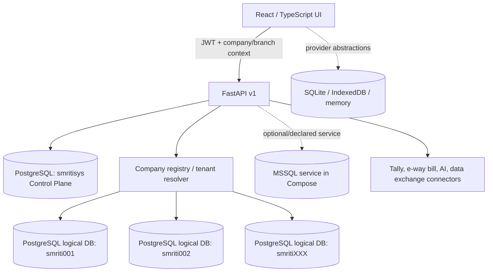

# SMRITI Retail OS — Complete Architecture Report

**Basis:** Static inspection of the current `smritiNX` worktree. Current worktree contains numerous pre-existing modifications and untracked files; this is not a clean-commit assessment.

## Architecture inventory

| Area | Observed implementation | Assessment |
|---|---|---|
| Frontend | React 18, TypeScript, Vite; `src/App.tsx` provides the application shell, workspace, login/company context, lazy-loaded views, notifications and layout providers. `src/` contains about 870 TypeScript/TSX files. | Broad modular UI; no deployed UI inspection. |
| API | FastAPI application at `backend/app/main.py`; API v1 modules under `backend/app/api/v1`; approximately 96 Python router files and over 1,200 route decorators in the current tree. | Routes are mounted via a registry, with a few modules mounted at multiple prefixes. No endpoint was called. |
| Backend layers | `app/api`, `app/services`, `app/repositories`, `app/models`, `app/schemas`, `app/db`, `app/core`, `app/middleware`, compliance modules and platform/event services. | Separation exists, but migration-era and legacy paths coexist. |
| Control Plane | `smritisys` is the central SQLAlchemy engine/session in `app/db/session.py`; registry, identity, user/role, menu, audit, configuration, UI metadata and integration registry ownership is declared in `app/db/ownership.py`. | Design is explicit; live contents and actual independence were not checked. |
| Company data | Dynamic SQLAlchemy engine/session cache resolves company IDs/codes to registered databases. `TenantContext` and `get_company_db` provide request-scoped routing. | Implemented in source, not verified per registered company. |
| Other database technology | `docker-compose.yml` declares PostgreSQL and MSSQL services. The frontend repository abstraction declares PostgreSQL, SQLite, IndexedDB and in-memory providers. Tally connector code exists. | No third independent SMRITI database was established. Runtime use of auxiliary providers/services is unknown. |
| Integrations | Tally connector/services, NIC e-way bill settings (sandbox URL and live calls disabled by default), Gemini API-key configuration, data exchange, e-commerce and provider/connector registries. | Source/config only; no external connection was attempted. |
| Background work | Report scheduler is opt-in in settings; backup scheduler defaults enabled; backup and reporting loops are started from FastAPI lifespan. | Worker multiplicity, persistence and operational schedules are not runtime-verified. |
| Deployment | Docker Compose has web, API, PostgreSQL and MSSQL; backend runs Gunicorn/Uvicorn workers. Database and service health checks exist. | No deployment, restart, backup or restore was executed. |
| Tests | 252 frontend test files observed; backend contains test suites and a guarded dedicated-PostgreSQL runner. | Frontend tests ran; backend tests were not run because they provision/migrate databases. |

## Logical architecture diagram

The diagram describes code/configuration intent, not confirmed live topology. PostgreSQL databases shown as tenant examples are logical databases under a common configured service in the repository's Compose file, not confirmed separate server instances.

## Application entry points and control flow

- Frontend entry point is Vite/React application composition in `src/App.tsx`.
- Backend entry point is `backend/app/main.py`, which imports many v1 modules, installs CORS/request logging/rate limiting/deprecation middleware, mounts `_ROUTER_REGISTRY`, adds health checks and runs startup/shutdown tasks.
- Backend container executes `backend/entrypoint.sh`; migration/bootstrap is attempted unless `SKIP_MIGRATIONS=true`, then Gunicorn runs with two workers by default.
- Database routing is split between Control Plane `async_session`, a company engine/session cache and tenant request dependencies.
- Frontend API calls are centered on `apiFetchV1`; a deprecated compatibility wrapper `apiFetch` remains.

## Implementation state categories

| Category | Evidence-based classification |
|---|---|
| Implemented in source | API routes, services, models, DTO/schema objects, frontend screens, connection resolver and multiple integrations are present. This does not certify operational behavior. |
| Implemented but unverified | Control Plane / tenant routing, business transaction flows, approval, inventory, billing, backup, scheduling and integration paths. No live API or DB execution was performed. |
| UI-only/local behavior | Training sandbox and frontend local/offline provider implementations are present. Their production/business-data authority is not established by this assessment. |
| Backend-only or UI-to-API parity uncertain | Numerous route modules and service files exist; complete route-to-screen traceability and runtime contract parity were not measured. |
| Deprecated/compatibility | `apiFetch` labels itself deprecated; main router includes legacy routes and aliases. |
| Planned/documented | Architecture and operational guides describe capabilities beyond locally verified runtime evidence. Documentation statements are not treated as proof of deployment. |

## Architecture risks

1. Alembic target filtering now uses canonical ownership metadata to exclude Control Plane-only tables from tenant migrations and tenant-only tables from Control Plane migrations (EA-DB-02); tests are added but not run.
2. The non-SYSADMIN default-company fallback and backup target/session fallbacks are removed in the working tree (EA-SEC-01, EA-DB-01); tests are added but not run.
3. Multiple router mounts and compatibility prefixes make endpoint ownership and duplicate behavior harder to reason about.
4. Compose/runtime versions do not match README claims (EA-ARCH-01); API mode and secret validation deployment behavior is ambiguous (EA-OPS-01).
5. There are 284 migration files in the current filesystem, including untracked control- and tenant-scoped migration heads. No database state or upgrade graph was executed.

## Architecture disposition

The project is a multi-layered retail platform with a clear two-tier database intent, not an independently proven “three database” system. The application has real physical/logical routing code; its actual production topology, schema separation and failure isolation remain unconfirmed. See [03_CONTROL_PLANE_DATABASE_ASSESSMENT.md](./03_CONTROL_PLANE_DATABASE_ASSESSMENT.md), [04_COMPANY_DATABASE_ASSESSMENT.md](./04_COMPANY_DATABASE_ASSESSMENT.md) and [13_RISK_REGISTER_REMEDIATION_ROADMAP.md](./13_RISK_REGISTER_REMEDIATION_ROADMAP.md).
