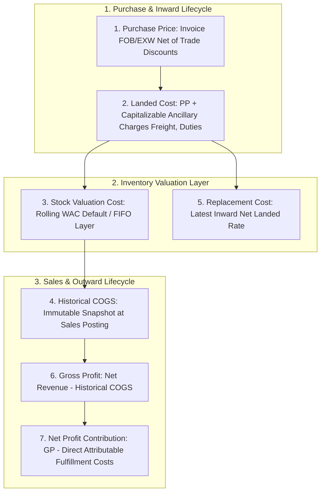
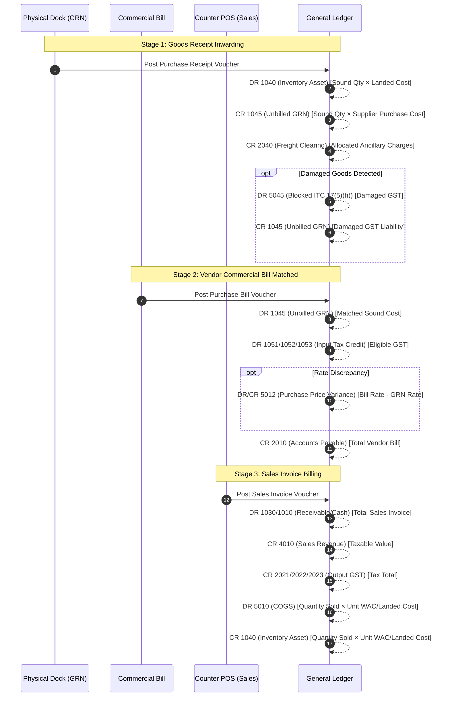

<!--
  Project      : SMRITI Retail OS
  Repository   : SMRITIRetailNX
  Organization : AITDL NETWORKS
  Author       : Jawahar Ramkripal Mallah
  Designation  : Chief Systems Architect & Creator
  Email        : support@smritibooks.com
  Websites     : smritibooks.com | erpnbook.com | aitdl.com
  Version      : 6.74.0
  Created      : 2026-10-14
  Modified     : 2026-10-14
  Copyright    : © SMRITIBooks.com. All Rights Reserved.
  License      : Proprietary Commercial Software
  Classification: Architecture Specification / Cost Truth Engine
-->

# SMRITI Retail OS — Cost Management & Cost Truth Engine Architecture Specification

**Status:** APPROVED (Architecture Design Phase 1 & 2)  
**Version:** 6.74.0  
**Domain:** Financial Accounting, Inventory Valuation & Cost Management  

---

## 1. Executive Summary & Foundational Principles

In retail enterprise resource planning, **Cost Truth** is the bedrock of business profitability, tax compliance, and inventory valuation. A disconnect between operational stock intake, ancillary landed charges, and General Ledger postings distorts financial statements and misleads management.

This architecture formalizes the **SMRITI Cost Management Engine (CME)**, guaranteeing:
1. **Single Source of Cost Truth**: Unifying 7 disparate cost price fields into a strictly governed, hierarchical cost authority.
2. **Standard Process by Default + Controlled System-Parameter Override**: Enterprise 4-tier configuration (`TERMINAL` > `BRANCH` > `COMPANY` > `GLOBAL`) governing inventory valuation method, tax treatment, and landed cost appropriation.
3. **Strict Double-Entry Accounting Parity (Ind AS 2 / AS 2)**: Introduction of Account `1045 (Unbilled GRN / GR-IR Clearing)` and Account `2040 (Freight & Landed Cost Payable)` to eliminate inventory and payable double-booking between goods receipt and vendor billing.
4. **Statutory Tax Compliance (Section 17(5)(h) CGST Act 2017)**: Explicit handling of Input Tax Credit (ITC) blockage and reversals on damaged or destroyed inward stock.
5. **Immutable Historical Cost Snapshots**: Preserving the exact valuation layer, unit cost, and gross profit recognized at the moment of invoice finalization, preventing silent retroactive mutations.

---

## 2. Authoritative Cost Definitions & Calculation Hierarchy

The engine defines 7 rigorous cost dimensions with authoritative source records, transaction triggers, tax treatments, and mathematical formulas:

### 1. Purchase Price (Buying Rate)
- **Definition**: The agreed unit procurement rate from the supplier, net of item-level and header-level commercial trade discounts, exclusive of refundable taxes.
- **Authoritative Source**: `purchase_receipt_items.cost_price` (backed by `purchase_order_items.cost_price`).
- **Formula**:
  $$\text{Purchase Unit Cost} = \frac{\text{Line Item Amount} - \text{Trade Discount}}{\text{Sound Quantity Received}}$$
- **Tax Treatment**: Recoverable GST (CGST/SGST/IGST) is excluded. Cash discounts are excluded from inventory cost and posted to Account `4020 (Discounts Received)`.

### 2. Landed Cost (Inward Capitalized Cost)
- **Definition**: The total cost incurred to bring an inventory item to its current location and condition, including invoice buying rate, freight, handling, insurance, entry levies, and non-refundable customs duties.
- **Authoritative Source**: `inward_cost_allocations` combined with `purchase_receipt_items`.
- **Formula**:
  $$\text{Unit Landed Cost} = \text{Purchase Unit Cost} + \sum \left( \frac{\text{Allocated Capitalizable Inward Charge}}{\text{Sound Quantity Received}} \right)$$
- **Tax Treatment**: Creditable GST on freight (under Forward Charge or Reverse Charge) is strictly excluded; non-creditable duties (Basic Customs Duty, Social Welfare Surcharge) are fully capitalized.
- **Apportionment Engine**: Hamilton-Hare Largest Remainder Method ensuring zero-cent penny rounding drift.

### 3. Stock Valuation Cost (Inventory Balance Sheet Value)
- **Definition**: The monetary value assigned to items remaining in stock at any given point in time, governed by the enterprise accounting policy.
- **Authoritative Source**: `product_cost_valuations.weighted_average_cost` (or active FIFO layers in `product_batch_stocks`).
- **Default Method**: **Rolling Weighted Average Cost (WAC)** per Ind AS 2 / AS 2.
- **Rolling WAC Formula**:
  $$\text{WAC}_{\text{new}} = \frac{(Q_{\text{current}} \times \text{WAC}_{\text{current}}) + (Q_{\text{inward}} \times \text{Landed Cost}_{\text{inward}})}{Q_{\text{current}} + Q_{\text{inward}}}$$
  *Edge Case Invariant*: If $Q_{\text{current}} \le 0$ (initial stock or recovering from temporary negative stock), $\text{WAC}_{\text{new}} = \text{Landed Cost}_{\text{inward}}$.

### 4. Historical Cost of Goods Sold (COGS)
- **Definition**: The direct cost assigned to units sold during a billing transaction, locked immutably at the instant of invoice creation.
- **Authoritative Source**: `transaction_cost_snapshots` (linked to `sales_invoice_items`).
- **Formula**:
  $$\text{Line COGS} = \text{Quantity Sold} \times \text{Unit Valuation Cost at Dispatch}$$
- **Immutability Invariant**: Historical COGS must **never** be retroactively recomputed when system parameters or future purchase costs change.

### 5. Replacement Cost
- **Definition**: The current market cost required to procure a fresh unit of inventory today.
- **Authoritative Source**: `product_cost_valuations.replacement_cost`.
- **Formula**: Updated to the latest confirmed purchase receipt landed unit cost:
  $$\text{Replacement Cost} = \text{Latest Unit Landed Cost}$$

### 6. Gross Profit & Gross Margin
- **Definition**: The commercial earnings generated from merchandise sales after absorbing direct merchandise acquisition cost.
- **Formula**:
  $$\text{Gross Profit} = \text{Net Taxable Sales Revenue} - \text{COGS}$$
  $$\text{Gross Margin \%} = \left( \frac{\text{Gross Profit}}{\text{Net Taxable Sales Revenue}} \right) \times 100$$

### 7. Net Profit Contribution (Waterfall Ledger)
- **Definition**: The true transactional bottom-line contribution of a sales document after deducting directly attributable sales commissions, payment gateway fees, loyalty costs, referral costs, and shipping/delivery expenses.
- **Authoritative Source**: `invoice_profitability_ledgers`.
- **Formula**:
  $$\text{Net Contribution} = \text{Gross Profit} - (\text{Commissions} + \text{Discounts} + \text{Loyalty} + \text{Referral} + \text{Delivery})$$

---

## 3. General Ledger Double-Entry Parity & GR/IR Clearing

### Elimination of Double-Booking
To resolve the critical GL posting defect identified in Phase 0, the chart of accounts is expanded with canonical clearing accounts:

| Code | Account Name | Type | Root Type | Purpose |
| :--- | :--- | :--- | :--- | :--- |
| **1040** | Inventory Asset | ASSET | ASSET | Physical inventory asset valuation |
| **1045** | Unbilled GRN (GR/IR Clearing) | LIABILITY | LIABILITY | Accrued goods receipt liability awaiting vendor bill |
| **2010** | Accounts Payable (Trade Creditors) | LIABILITY | LIABILITY | Authoritative vendor liability for payment |
| **2040** | Freight & Landed Cost Payable | LIABILITY | LIABILITY | Transporter and handling charges clearing |
| **5010** | Cost of Goods Sold (COGS) | EXPENSE | EXPENSE | Direct inventory expense upon sale |
| **5012** | Purchase Price Variance (PPV) | EXPENSE | EXPENSE | Discrepancy between GRN purchase rate and vendor bill rate |
| **5045** | Blocked / Ineligible ITC Expense | EXPENSE | EXPENSE | GST ITC blocked under Section 17(5)(h) on damaged goods |

### Accounting Posting Matrix

---

## 4. Controlled System-Parameter Overrides

Leveraging `SystemParameterService`, cost policies are governed by enterprise parameters supporting 4-tier inheritance (`TERMINAL` > `BRANCH` > `COMPANY` > `GLOBAL`):

| Parameter Key | Mutability Tier | Default Value | Allowed Values | Description |
| :--- | :--- | :--- | :--- | :--- |
| `SMRITI.COST.VALUATION_METHOD` | `COMPANY_ADMIN` | `WEIGHTED_AVERAGE` | `WEIGHTED_AVERAGE`, `FIFO`, `LANDED_COST`, `LAST_PURCHASE` | Inventory valuation algorithm used for inventory balance sheet and COGS. |
| `SMRITI.COST.INCLUDE_LANDED_IN_COGS` | `COMPANY_ADMIN` | `TRUE` | `TRUE`, `FALSE` | Dictates whether allocated freight and duties are included in recognized COGS. |
| `SMRITI.COST.ITC_TREATMENT_POLICY` | `COMPANY_ADMIN` | `STANDARD_IN_AS2` | `STANDARD_IN_AS2`, `CAPITALIZE_ALL`, `EXPENSE_ALL` | Policy for tax treatment; standard auto-excludes eligible ITC and blocks damaged 17(5)(h). |
| `SMRITI.COST.VARIANCE_ALERT_PERCENT` | `BRANCH_ADMIN` | `10.0` | `1.0` - `100.0` | Threshold percentage triggering an exception alert when purchase cost deviates from WAC. |
| `SMRITI.COST.ALLOW_NEGATIVE_STOCK_SALE` | `RESTRICTED_ADMIN` | `TRUE` | `TRUE`, `FALSE` | Controls whether billing can occur when physical stock is zero/negative; costs snapshot at latest WAC. |

---

## 5. Cost Truth Reporting Suite Specification

The engine provides 10 authoritative, drill-down enabled reports:

1. **Purchase Cost and Purchase Variance Report**: Tracks PO rate vs GRN rate vs Bill rate per SKU, identifying price escalations.
2. **Landed Cost Breakdown Report**: Itemizes base purchase cost, freight, cartage, handling, customs duties, and apportionment methodology per receipt.
3. **GST & ITC Reconciliation Report**: Reconciles Total Inward Tax, Eligible ITC (Account 1051-1053), and Blocked ITC under Section 17(5)(h) (Account 5045).
4. **Current Stock Valuation Report**: Compares physical stock valuation across WAC, FIFO, Standard Cost, and Replacement Cost.
5. **Item / SKU Cost History Report**: Full chronological audit trail of all cost revisions, inward receipts, and valuation fluctuations for any SKU.
6. **COGS & Gross Profit Report**: Detailed sales-level gross margin report linking invoice line items to recognized COGS snapshots.
7. **Supplier Cost Comparison Report**: Benchmark purchase costs for identical SKUs across multiple vendors.
8. **Cost Variance and Exception Report**: Surfaces operational anomalies (zero-cost sales, margin < 0%, price spike > threshold).
9. **Cost Adjustment Audit Trail**: Logs late-arriving freight adjustments and system parameter modifications with reason codes and user signatures.
10. **Inventory-to-General-Ledger Reconciliation**: Matches live physical inventory valuation ($\sum \text{Stock} \times \text{WAC}$) directly against General Ledger Account `1040 (Inventory Asset)`, verifying zero financial drift.
