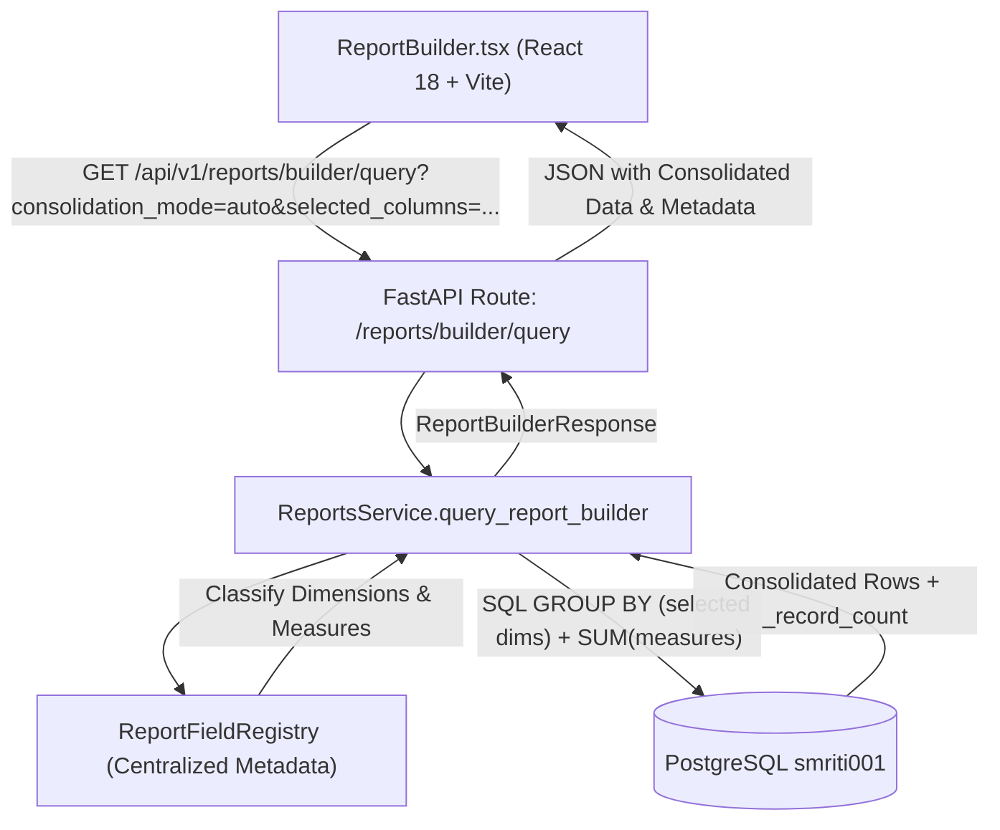

<!--
  Project      : SMRITI Retail OS
  Repository   : SMRITIRetailNX
  Organization : AITDL NETWORKS
  Author       : Jawahar Ramkripal Mallah
  Designation  : Chief Systems Architect & Creator
  Email        : support@smritibooks.com
  Websites     : smritibooks.com | erpnbook.com | aitdl.com
  Version      : 1.0.0
  Created      : 2026-10-22
  Modified     : 2026-10-22
  Copyright    : © SMRITIBooks.com. All Rights Reserved.
  License      : Proprietary Commercial Software
  Target UI    : SMRITI BI & Reporting Center — Report Designer / Report Builder
  Classification: Internal
-->

# SMRITI Report Designer: Intelligent Auto-Consolidation & Dynamic Grouping Implementation Plan

**Plan Version:** 1.0.0  
**Domain Area:** Reports & BI (`docs/implementation/reports/`)  
**Status:** In Progress  
**Governance Standard:** Implementation Plan Governance Policy (IPGP-v1.0), 19 Required Sections  
**Target Systems:**
- `backend/app/services/report_field_registry.py` (New Centralized Metadata-Driven Aggregation Registry)
- `backend/app/services/reports.py` (`ReportsService.query_report_builder`)
- `backend/app/api/v1/reports.py` (`GET /api/v1/reports/builder/query`)
- `backend/app/schemas/reports.py` (`ReportBuilderResponse`)
- `src/components/reports/ReportBuilder.tsx` (Dynamic Consolidation UX, Auto/Detailed/GroupBy Mode, Drill-down)
- `src/tests/reportBuilderAutoConsolidation.test.ts` (Automated Frontend Unit Tests)
- `backend/app/tests/test_report_builder_auto_consolidation.py` (Automated Backend Pytest Integration Tests)

---

## 1. Objective

Implement intelligent, metadata-driven row auto-consolidation in the SMRITI BI & Reporting Center (Report Designer / Report Builder). When multiple database records share identical values across selected report columns, consolidate them into a single row with mathematically verified aggregate measures in the server-side query layer, rather than displaying repetitive lines or masking duplicates in the browser DOM.

---

## 2. Business Motivation

In retail ERP reporting (e.g. Footwear, Apparel, General Merchandise), transactional item tables store line items at the style-color-size level (e.g., Article `CH-01`, Color `Black`, Size `7`, Size `8`, Size `9`). When business users, purchasing managers, or store merchandisers generate summary reports focusing on high-level dimensions (such as Supplier, PO No, Article, or Color), raw line queries produce repetitive rows for every individual size variant.
Displaying redundant lines creates visual clutter, slows report comprehension, and complicates reconciliations. Conversely, naive frontend de-duplication or SQL `DISTINCT` discards quantities and amounts or fails on paginated sets.
Intelligent auto-consolidation delivers executive-ready summary rows with correct aggregated measures (SUM for quantity/amount, weighted average for rates) while dynamically splitting into variant rows the moment a user selects finer dimensions like Size or Color.

---

## 3. Scope

1. **Server-Side Aggregation Engine**:
   - Centralized field classification registry (`report_field_registry.py`) categorizing fields into Grouping Dimensions, Additive Measures, Non-Additive Measures, and Count Measures.
   - Dynamic SQL `GROUP BY` generation based on selected dimensions in `ReportsService.query_report_builder`.
   - Join inflation protection: eradicating 1-to-many Cartesian multiplication (e.g., `PurchaseBill` joins against `PurchaseOrder`).
2. **Multi-Domain Support**:
   - Full consolidation across `Purchase`, `Sales`, `Inventory`, `Items`, `Suppliers`, `Customers`, and `Finance`.
3. **Consolidation Modes**:
   - `Auto` (Default): Automatically group by currently selected grouping dimensions and aggregate compatible measures.
   - `Detailed Rows`: Display granular line-level transactions without grouping.
   - `Group By`: Explicitly choose grouping dimensions irrespective of displayed measure columns.
4. **Report Designer UX**:
   - Row Consolidation toolbar toggle (`Auto`, `Detailed`, `Group By`).
   - Consolidated badge indicator (`N items`) on consolidated rows with underlying record count.
   - Interactive drill-down drawer / popover showing underlying item records.
   - Dynamic reactivity: adding/removing columns immediately updates consolidation.
   - Sorting, pagination, grand totals, and exports respect consolidated groupings.
5. **Testing & Verification**:
   - Comprehensive Vitest and Pytest test suites verifying consolidation, dimension splitting, measure aggregation, join protection, pagination, and tenant isolation.

---

## 4. Current State

- `ReportsService.query_report_builder` executes flat `SELECT` queries without SQL `GROUP BY`.
- In `Purchase`, `PurchaseOrderItem` outer joins `PurchaseBill` on `order_id == PurchaseOrder.id`, creating risks of Cartesian row multiplication if multiple bills exist.
- Selecting high-level columns (e.g. Supplier + PO No) produces repetitive rows for each variant size line item.
- `ReportBuilder.tsx` renders all records returned by the backend without consolidation controls or grouping awareness.

---

## 5. Gap Analysis

| Capability | Current State | Required State | Severity |
|---|---|---|---|
| Row Consolidation | None (Flat line items only) | Intelligent auto-consolidation based on selected dimensions | Critical |
| Aggregation Engine | Hardcoded `SUM` on entire table | Metadata-driven dimensional `GROUP BY` and typed measure aggregation | Critical |
| Dimension Reactivity | None | Adding a dimension splits rows; removing consolidates rows | High |
| Join Inflation Guard | Direct 1:N outer joins | Correlated subqueries or pre-aggregates preventing item multiplication | Critical |
| UX Controls | Missing consolidation selector | Intuitive Auto / Detailed / Group By selector and consolidated badges | Medium |
| Drill-down Capability | None | Drill-down view into underlying item records of a consolidated row | Medium |

---

## 6. Architecture Impact



- Zero breaking API changes: `consolidation_mode` defaults to `"auto"`, backwards-compatible with existing clients.
- Database queries remain fully parameterized and multi-tenant isolated via `company_id`.

---

## 7. Proposed Design

### A. Field Classification Rules
- **Grouping Dimensions**: `supplier`, `supplier_code`, `city`, `po_no`, `po_date`, `invoice_no`, `article_sku`, `color`, `size`, `customer_name`, `sale_invoice_no`, `sale_date`, `warehouse`, `item_code`, `item_name`, `item_category`, `brand`, `payment_mode`, `account_code`, `account_name`.
- **Additive Measures**: `quantity`, `net_amount`, `gross_total`, `tax_amount`, `stock_on_hand`, `reserved_qty`, `available_qty`, `valuation_cost`, `debit_total`, `credit_total`.
- **Non-Additive Measures**: `mrp`, `standard_cost`, `selling_price`, `reorder_level` (handled via weighted average or min/max).
- **Count Measures**: `po_count`, `grn_count`, `_record_count` (aggregated via `COUNT(DISTINCT ...)`).

### B. Safe Join Policy
To prevent Cartesian multiplication when document headers have multiple child bills:
```python
# Use scalar subquery or string aggregation for invoice_no
select(PurchaseBill.bill_no).where(PurchaseBill.order_id == PurchaseOrder.id).limit(1).scalar_subquery()
```

---

## 8. Files Created

1. `backend/app/services/report_field_registry.py`: Centralized metadata catalog and classification logic.
2. `src/tests/reportBuilderAutoConsolidation.test.ts`: Frontend Vitest test suite for consolidation rules.
3. `backend/app/tests/test_report_builder_auto_consolidation.py`: Backend Pytest test suite for query consolidation and join safety.
4. `docs/implementation/reports/Report_Designer_Auto_Consolidation_Plan_v1.0.0.md`: This IPGP plan.
5. `docs/walkthrough/reports/Report_Designer_Auto_Consolidation_Walkthrough_v1.0.0.md`: WGP Walkthrough.

---

## 9. Files Modified

1. `backend/app/schemas/reports.py`: Add `consolidation_mode` and `active_dimensions` to `ReportBuilderResponse`.
2. `backend/app/api/v1/reports.py`: Add `consolidation_mode`, `selected_columns`, and `group_by_columns` query parameters.
3. `backend/app/services/reports.py`: Implement server-side dynamic grouping, aggregation, join protection, and count calculation.
4. `src/components/reports/ReportBuilder.tsx`: Add Consolidation mode controls, column change reactivity, consolidated badge, and drill-down viewer.
5. `docs/implementation/README.md`: Append plan entry.
6. `docs/walkthrough/README.md`: Append walkthrough entry.
7. `CHANGELOG.md`: Log release changes.

---

## 10. Dependencies

- PostgreSQL 15+ (`smriti001`)
- SQLAlchemy 2.0+ (AsyncSession, func.sum, func.count, scalar_subquery)
- React 18, Vite, Lucide React
- Vitest 4+, Pytest 8+

---

## 11. Risks & Mitigation

| Risk | Impact | Mitigation Strategy |
|---|---|---|
| Cartesian join inflation from 1:N relations | High (Inflated monetary amounts) | Replace 1:N outer joins with correlated scalar subqueries or pre-aggregated CTEs |
| Performance on large datasets | Medium (Query latency) | Use indexed grouping keys and perform grouping strictly within PostgreSQL |
| Column toggling race conditions | Low (UI flicker) | Abort prior fetch or use latest request sequence token |

---

## 12. Rollback Strategy

If regressions occur, revert commit `d1a0de03` or set default `consolidation_mode="detailed"`. All database schemas remain untouched (pure query and projection layer changes).

---

## 13. Verification Plan

1. Verify server-side SQL grouping across selected dimensions in `Purchase` and other domains.
2. Verify adding `Size` splits rows; removing `Size` consolidates rows into 1 row with summed Quantity and Net Amount.
3. Verify grand totals match exactly between Detailed and Auto Consolidated modes.
4. Verify join protection prevents inflation when multiple bills/orders exist.
5. Verify frontend UI controls (Auto / Detailed / Group By) and drill-down badge.

---

## 14. Test Plan

- Unit test field classification registry for dimensions and measures.
- Backend integration tests verifying:
  - Consolidating identical (Supplier, PO, Article, Color) lines into 1 row.
  - Correct mathematical SUM of `quantity` and `net_amount`.
  - Splitting when `size` is selected.
  - Multi-tenant isolation enforcement.
- Frontend test verifying:
  - Query parameters contain `consolidation_mode` and `selected_columns`.
  - Grid displays consolidated rows and record count badges.
  - Column removal triggers dynamic re-consolidation.

---

## 15. Documentation Impact

- Update `docs/implementation/README.md`
- Update `docs/walkthrough/README.md`
- Create `docs/walkthrough/reports/Report_Designer_Auto_Consolidation_Walkthrough_v1.0.0.md`
- Update `CHANGELOG.md`

---

## 16. Deployment Plan

Deploy code to development (`D:\Smriti_Retail_OS`), run test suites, commit to `origin/smritiNX`, and verify via test environment (`F:\SMRITRretailNX`).

---

## 17. Status

**Status:** In Progress (Approved for implementation)

---

## 18. Related ADRs

- `docs/architecture/ADR_REPORT_EXECUTION.md`
- `docs/architecture/ADR_REPORT_BUILDER_DATA_BINDING.md`

---

## 19. Related Walkthroughs

- `docs/walkthrough/reports/Report_Builder_Live_Data_Binding_Walkthrough_v1.1.0.md`
- `docs/walkthrough/reports/Visual_Reports_Database_To_UX_Audit_And_Autofix_v1.0.0.md`
- `docs/walkthrough/reports/Report_Designer_Auto_Consolidation_Walkthrough_v1.0.0.md`
