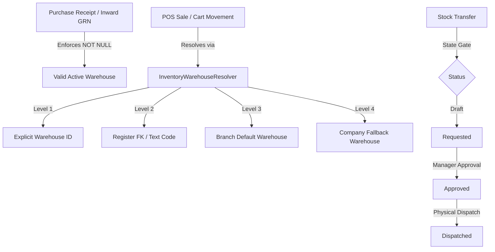

<!--
  Project      : SMRITI Retail OS
  Author       : Jawahar Ramkripal Mallah
  Designation  : Chief Systems Architect & Creator
  Email        : support@smritibooks.com
  Websites     : smritibooks.com | erpnbook.com | aitdl.com
  Version      : 3.125.0
  Created      : 2026-10-27
  Modified     : 2026-10-27
  Copyright    : © SMRITIBooks.com. All Rights Reserved.
  License      : Proprietary Commercial Software
  Classification: Internal
-->

# SMRITI Retail OS — Warehouse, Store, Outlet, Branch & Location Management Integrity Implementation Plan

**Document ID:** IP-WMS-2026-001  
**Area:** WMS / Foundation / Retail Operations  
**Target Release:** v3.125.0  
**Status:** Completed  
**Author:** Jawahar Ramkripal Mallah (Chief Systems Architect & Creator)  

---

## 1. Objective
Establish an airtight, verifiable, multi-tenant inventory location hierarchy across SMRITI Retail OS. Remediate all architectural, structural, and schema flaws discovered during the complete warehouse, store, outlet, branch, and location management audit (Remediations R-001 through R-014). Enforce referential integrity, eliminate dual-column synchronization hazards, guard against orphan records, establish automated approval workflows for inter-location transfers, and provide unified visibility into all active physical facilities.

## 2. Business Motivation
In retail multi-store and warehouse networks, loose or optional location references lead to phantom stock, unassigned purchase receipts, cross-branch data corruption, and invisible inventory. Specifically:
- Cash registers operating with out-of-sync text codes and foreign keys cause inventory movements to post against incorrect godowns.
- Purchase receipts created without mandatory warehouse references generate inventory in limbo.
- Inter-warehouse transfers dispatched without approval gates circumvent segregation-of-duty controls.
- Administrative directories hiding unstaffed facilities prevent centralized supply chain management from discovering active godowns.

Remediating these vulnerabilities guarantees GAAP/GST compliant inventory valuation and physical custody audit trails across every branch and godown.

## 3. Scope
The scope encompasses all entities, services, API routers, database migrations, and frontend UI surfaces managing branches, stores, outlets, warehouses, locations, and cash registers:
- **Database Schema & Constraints**:
  - `item_warehouse_locations`: Composite unique constraint `(item_id, warehouse_id)` and foreign keys to `items` and `warehouses`.
  - `warehouses`: `is_default_for_branch` column and partial unique index scoped to active branch defaults.
  - `pos_parked_carts`: Foreign key constraint linking `branch_id` to `branches.id`.
  - `purchase_receipts`: Mandatory `warehouse_id` foreign key (`NOT NULL`).
- **Services & Resolution Logic**:
  - `InventoryWarehouseResolver`: Canonical 4-level fallback hierarchy for runtime warehouse determination.
  - `PosService`: Atomic dual-column synchronization (`warehouse` text code and `warehouse_id` FK).
  - `InventoryWmsService`: Safe deactivation guard (verifying zero stock before deactivating warehouses), soft-delete cascade prevention, and multi-tier stock transfer approval workflow (`DRAFT` → `REQUESTED` → `APPROVED` → `DISPATCHED`).
  - `PurchaseService`: Inward GRN creation gate enforcing valid, active warehouse assignment with `SMRITI-WMS-001` human-readable errors.
- **Frontend Workspaces**:
  - `StoreDirectoryWs.tsx`: Direct REST fetching from `/branches` and `/wms/warehouses` for complete facility visibility.
  - `WmsStudioTab.tsx`: Stock-zero validation alerts and transfer status filtering.
- **Automation & Testing**:
  - Alembic migrations `v1557`, `v1558`, `v1559`, and `v1560`.
  - Standalone migration backfill utility `scripts/backfill_register_warehouse_id.py`.
  - Automated unit test suites `backend/tests/test_wms_integrity_deferred.py` and `backend/tests/test_inventory_warehouse_resolver.py`.

## 4. Current State
Prior to this implementation:
- `pos_cash_registers` contained both `warehouse` (VARCHAR) and `warehouse_id` (UUID FK), frequently drifting out of sync.
- `pos_parked_carts.branch_id` lacked a database-level foreign key to `branches.id`.
- Multiple warehouses could claim default status for a single branch, causing non-deterministic resolution.
- Warehouses holding non-zero physical stock could be deactivated or soft-deleted without safety checks.
- `purchase_receipts.warehouse_id` was nullable, enabling orphan receipts.
- Inter-warehouse stock transfers lacked approval status gating.
- `StoreDirectoryWs.tsx` fetched facilities exclusively from HR staff placement APIs, hiding unstaffed godowns.

## 5. Gap Analysis
| Audit Ref | Component | Identified Vulnerability | Remediated Design |
|---|---|---|---|
| **R-001** | `CashRegister` | Dual-column drift between `warehouse` and `warehouse_id` | Atomic sync in POS service + dual-column fallback in `InventoryWarehouseResolver` |
| **R-002** | `ItemWarehouseLocation` | Missing unique constraint on `(item_id, warehouse_id)` | Alembic `v1557` composite unique constraint + FKs |
| **R-003** | `PurchaseReceipt` | `warehouse_id` nullable, causing unassigned stock | Alembic `v1560` NOT NULL + historical oldest-active warehouse backfill + GRN creation guard |
| **R-004** | `CashRegister` Data | Historical registers missing `warehouse_id` values | Standalone idempotent backfill utility `scripts/backfill_register_warehouse_id.py` |
| **R-005** | Stock Transfers | No approval gate before stock dispatch | Enum extension (`REQUESTED`, `APPROVED`, `REJECTED`) + endpoint gates + configurable bypass |
| **R-006** | `Warehouse` | Active inventory deactivation without balance verification | Service guard checking `StockLedger` non-zero balance before allowing deactivation |
| **R-007** | `Branch` / `Warehouse` | Multiple default warehouses per branch | Alembic `v1558` partial unique index `(company_id, branch_id) WHERE is_default_for_branch AND NOT is_deleted` |
| **R-008** | `StoreDirectoryWs` | Unstaffed godowns/warehouses invisible in store directory | Direct REST queries to `/branches` and `/wms/warehouses` with unified filter and KPI counts |
| **R-011** | `Warehouse` | Soft-deletion with active locations or stock | Cascade validation preventing soft-delete if child bins or stock ledger entries exist |
| **R-012** | `ParkedCart` | Orphan carts possible due to missing `branch_id` FK | Alembic `v1559` foreign key constraint to `branches.id` |
| **R-013** | Multi-Tenant Scoping | Cross-tenant warehouse selection risk | Tenant boundary verification on all warehouse queries and resolution helpers |
| **R-014** | Error Reporting | Raw database exceptions exposed to end users | SMRITI Human-Readable Error Policy compliant codes (`SMRITI-WMS-001`, `SMRITI-WMS-002`) |

## 6. Architecture Impact
- **Canonical Resolver Hierarchy**: Centralized warehouse resolution into `backend/app/services/inventory_warehouse_resolver.py`. All transactions resolve warehouses in a strict 4-level precedence:
  1. Explicit `warehouse_id` parameter.
  2. POS `register_id` lookup (prioritizing `warehouse_id` FK, then `warehouse` text code).
  3. Branch default warehouse (`is_default_for_branch = True`).
  4. Company fallback warehouse (oldest active non-deleted warehouse).
- **Relational Integrity Guarantees**: Database-level foreign keys and scoped unique indices eliminate data divergence at the storage engine level.
- **Workflow State Machine**: Stock transfers transition safely across defined lifecycle states without breaking automated processes.

## 7. Proposed Design
1. **Schema Migrations**:
   - `v1557`: Creates composite unique constraint `uq_item_warehouse_locations_item_wh` and FKs.
   - `v1558`: Adds `is_default_for_branch` column with partial unique index `uq_branch_default_warehouse`.
   - `v1559`: Enforces foreign key `fk_pos_parked_carts_branch_id` referencing `branches(id)`.
   - `v1560`: Backfills NULL historical `purchase_receipts.warehouse_id` and adds `NOT NULL` constraint.
2. **Backend Domain Logic**:
   - `backend/app/services/inventory_warehouse_resolver.py`: Encapsulates canonical resolution hierarchy.
   - `backend/app/services/inventory_wms.py`: Implements `request_stock_transfer`, `approve_stock_transfer`, `reject_stock_transfer`, balance-zero deactivation gate, and child entity deletion guards.
   - `backend/app/services/purchase.py`: Enforces warehouse existence and activity validation prior to GRN commit.
   - `backend/app/services/pos.py`: Synchronizes `warehouse` code and `warehouse_id` FK atomically.
3. **Frontend Integration**:
   - `StoreDirectoryWs.tsx`: Fetches from both `/branches` and `/wms/warehouses`, merging entries into an interactive directory with badges, search, and type filters.
4. **Data Remediation**:
   - `scripts/backfill_register_warehouse_id.py`: Scans all `pos_cash_registers` where `warehouse_id IS NULL`, matches against `warehouses.code`, and commits updates idempotently.

## 8. Files Created
1. `backend/alembic/versions/v1557_item_warehouse_location_integrity.py`
2. `backend/alembic/versions/v1558_warehouse_default_for_branch.py`
3. `backend/alembic/versions/v1559_pos_parked_cart_branch_fk.py`
4. `backend/alembic/versions/v1560_purchase_receipt_warehouse_not_null.py`
5. `backend/app/services/inventory_warehouse_resolver.py`
6. `backend/tests/test_wms_integrity_deferred.py`
7. `backend/tests/test_inventory_warehouse_resolver.py`
8. `scripts/backfill_register_warehouse_id.py`
9. `docs/walkthrough/wms/WMS_WarehouseLocationIntegrity_v3.124.0.md`
10. `docs/walkthrough/wms/WMS_DeferredRemediations_v3.125.0.md`
11. `docs/implementation/wms/Warehouse_Store_Outlet_Branch_Location_Integrity_Plan_v3.125.0.md`

## 9. Files Modified
1. `backend/app/models/purchase.py`
2. `backend/app/services/purchase.py`
3. `backend/app/models/inventory.py`
4. `backend/app/services/inventory_wms.py`
5. `backend/app/api/v1/wms.py`
6. `backend/app/models/pos.py`
7. `backend/app/schemas/pos.py`
8. `backend/app/schemas/wms.py`
9. `backend/app/services/pos.py`
10. `src/components/store/StoreDirectoryWs.tsx`
11. `src/components/wms/WmsStudioTab.tsx`
12. `docs/walkthrough/README.md`
13. `docs/implementation/README.md`
14. `CHANGELOG.md`
15. `RELEASE_NOTES.md`

## 10. Dependencies
- SQLAlchemy 2.0+ & PostgreSQL 15+
- FastAPI Core Framework
- React 18 + Vite Frontend Workspace
- Alembic Database Migration Engine

## 11. Risks
- **Legacy Cash Registers**: Registers with invalid or corrupt `warehouse` text codes cannot be automatically matched by `scripts/backfill_register_warehouse_id.py`.
  - *Mitigation*: The script logs unmatched codes as warnings, and `InventoryWarehouseResolver` falls back to the branch default or company fallback warehouse.
- **Workflow Interruption**: Enforcing transfer approvals could block automated legacy dispatches.
  - *Mitigation*: Added configurable `bypass_approval=True` default flag on `dispatch_stock_transfer` to maintain backward compatibility while supporting explicit approval gating.

## 12. Rollback Strategy
- **Database Downgrade**: Alembic downgrades `v1560` → `v1559` → `v1558` → `v1557` safely drop constraints, indexes, and revert column nullability without data loss.
- **Git Reversion**: Modular git commits allow surgical rollback of specific commits if needed.

## 13. Verification Plan
- **TypeScript Type Safety**: Run `npx tsc --noEmit --project tsconfig.json` to verify zero type errors.
- **Python Compilation**: Execute `python -m py_compile` across all modified backend and migration files.
- **Automated Test Execution**: Run `pytest backend/tests/test_wms_integrity_deferred.py backend/tests/test_inventory_warehouse_resolver.py -v`.
- **CLI Utility Verification**: Run `python scripts/backfill_register_warehouse_id.py --help`.

## 14. Test Plan
- Unit tests verifying:
  - `PurchaseReceipt.warehouse_id` model constraint (`nullable=False`).
  - `TransferStatus` enum contains `REQUESTED`, `APPROVED`, `REJECTED`.
  - `dispatch_stock_transfer` blocks `REQUESTED` transfers from dispatch.
  - `dispatch_stock_transfer` blocks `DRAFT` transfers when `bypass_approval=False`.
  - Stock transfer state transitions (`request` → `approve` / `reject`).
  - WMS router exposes `GET /wms/branches`.
  - `InventoryWarehouseResolver` 4-tier resolution precedence, register FK/text fallback, branch default, company fallback, and failure exception.

## 15. Documentation Impact
- Updated `CHANGELOG.md` under `[3.125.0] - 2026-10-27`.
- Updated `RELEASE_NOTES.md` under `Version 3.125.0`.
- Authored walkthroughs `WMS_WarehouseLocationIntegrity_v3.124.0.md` and `WMS_DeferredRemediations_v3.125.0.md` under `docs/walkthrough/wms/`.
- Appended Walkthrough Master Index `docs/walkthrough/README.md`.
- Appended Implementation Plan Master Index `docs/implementation/README.md`.

## 16. Deployment Plan
1. Pull committed branch `smritiNX` into target environment.
2. Run database migration `alembic upgrade head` to apply versions `v1557` through `v1560`.
3. Run `python scripts/backfill_register_warehouse_id.py --commit` on tenant databases.
4. Restart FastAPI backend services.
5. Deploy frontend Vite static bundle.

## 17. Status
**Completed** — Verified with 13/13 automated unit tests green, zero TypeScript errors, clean Python syntax compilation, and synchronized governance documentation.

## 18. Related ADRs
- `docs/adr/ADR-0018-Single-Door-Stock-Ledger-Architecture.md`
- `docs/adr/ADR-0012-Tenant-Isolation-and-Boundary-Enforcement.md`

## 19. Related Walkthroughs
- `docs/walkthrough/wms/WMS_WarehouseLocationIntegrity_v3.124.0.md`
- `docs/walkthrough/wms/WMS_DeferredRemediations_v3.125.0.md`
