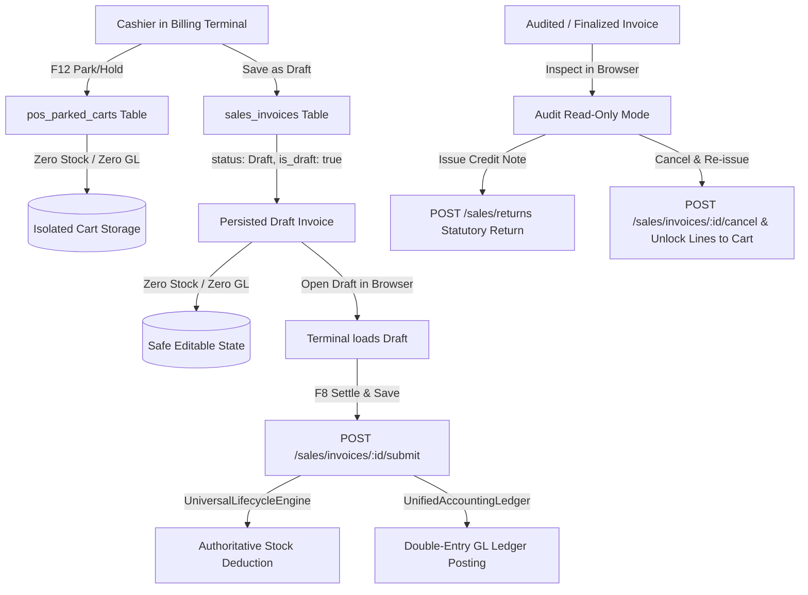

<!--
  Project      : SMRITI Retail OS
  Author       : Jawahar Ramkripal Mallah
  Designation  : Chief Systems Architect & Creator
  Email        : support@smritibooks.com
  Websites     : smritibooks.com | erpnbook.com | aitdl.com
  Version      : 6.99.2
  Created      : 2026-10-30
  Modified     : 2026-10-30
  Copyright    : © SMRITIBooks.com. All Rights Reserved.
  License      : Proprietary Commercial Software
  Classification: Canonical Billing Engine
-->

# Walkthrough: SMRITI Billing Draft, Submit, Parked Cart & Statutory Amendment Lifecycle v6.99.2

## 1. Purpose
This release implements the complete end-to-end operational and statutory lifecycle for billing invoices across POS, retail, wholesale, and distributor billing channels in SMRITI Retail OS. It strictly resolves the previous issue where holding/parking a bill (`F12`) triggered outward WMS batch deductions, customer ledger debits, and coupon consumption, while establishing a compliant Save as Draft protocol and statutory Amendment/Credit-Note workflows per ADR-005.

---

## 2. Scope
- **Isolated Cart Parking (F12 Hold/Park):** Transitioned terminal suspension from `POST /sales/invoices` to the dedicated `pos_parked_carts` table (`POST /api/v1/pos/parked-carts`), preventing stock and GL mutations on held carts.
- **Formal Draft Invoices:** Added `is_draft` schema flag across `SalesInvoiceCreate`, `CanonicalPostingRequest`, and `CanonicalSalesPostingWriter`. Draft invoices persist under `SalesInvoice` with `status="Draft"` with zero stock movement, zero GL ledger entries, zero coupon consumption, and zero customer credit debiting.
- **Draft Promotion (Submit to Posted):** Implemented `POST /api/v1/sales/invoices/{invoice_id}/submit` delegating to `UniversalLifecycleEngine` (`POST` transition) which executes authoritative batch deduction via `SalesStockAuthority` and double-entry GL posting via `UnifiedAccountingLedgerService`.
- **Statutory Amendment Actions (ADR-005):** In-place mutating of finalized GST invoices is strictly prohibited. Added "Issue Credit Note" (`POST /sales/returns`) and supervisor "Cancel & Re-issue to Cart" (`POST /sales/invoices/{id}/cancel` followed by unlocking line items into the billing terminal cart).
- **Interactive UI Banners & Badges:** Rendered "Draft Invoice Active" banner when editing a draft bill, "Audit Read-Only Mode" banner with statutory amendment actions when inspecting posted bills, and "Open Draft" in the Invoicing Transaction Browser.

---

## 3. Files Created
1. `src/tests/billingDraftSubmitLifecycle.test.ts` — Frontend unit test suite verifying isolated parked carts, draft payload schema, document loading state differentiation, and statutory amendment payloads.
2. `docs/implementation/billing/Billing_Draft_Submit_Amend_Lifecycle_Plan_v6.99.2.md` — Canonical IPGP 19-section Implementation Plan.
3. `docs/walkthrough/billing/Billing_Draft_Submit_Amend_Lifecycle_v6.99.2.md` — Canonical WGP 13-section Walkthrough Document.

---

## 4. Files Modified
1. `backend/app/schemas/canonical_posting.py` — Added `is_draft: bool = Field(False)` to `CanonicalPostingRequest`.
2. `backend/app/schemas/sales.py` — Added `is_draft: bool = Field(False)` to `SalesInvoiceCreate`.
3. `backend/app/services/canonical_sales_writer.py` — Guarded `status="Draft" if req.is_draft else "Submitted"`; bypassed customer PO allocations, coupon redemptions, credit ledger debiting, and physical stock mutation (`wms_svc.atomic_mutate_batch_stock`).
4. `backend/app/services/sales.py` — Propagated `is_draft` flag, implemented `submit_draft_sales_invoice`, and hardened `cancel_sales_invoice` to only reverse stock/GL if invoice was actually posted.
5. `backend/app/api/v1/sales.py` — Added `POST /api/v1/sales/invoices/{invoice_id}/submit` endpoint and imported `User` model.
6. `backend/alembic/versions/v1566_business_environments_master_registry.py` — Renamed from `v1508` to `v1566` to resolve duplicate head migration conflict in ephemeral test environments.
7. `src/components/billing/BillingTerm.tsx` — Updated `handleSuspendInvoice` to isolated `/pos/parked-carts`, added `handleRecallInvoice` with server recall, added `handleDiscardSuspendedBill`, added `handleSaveDraftInvoice`, added `handleCancelAndReissue` and `handleIssueCreditNote`, rendered Draft and Audit banners, added Draft buttons in More Menu and Action Bar.
8. `src/components/billing/InvoicingTransactionBrowserModal.tsx` — Added "Open Draft" button for bills in `DRAFT` status.
9. `docs/implementation/README.md` — Appended v6.99.2 Implementation Plan.
10. `docs/walkthrough/README.md` — Appended v6.99.2 Walkthrough entry.

---

## 5. Architecture Decisions
- **ADR-005 Statutory Invariance:** Indian GST law (CGST Act 2017 Sec 31/34) prohibits in-place mutation or revision chains of issued tax invoices. Invoices already submitted to the tax ledger cannot be overwritten. Corrections must take the form of statutory Credit Notes or formal voiding with stock reversal.
- **Cart Isolation vs Financial Draft Separation:** Short-term lane suspensions (e.g., cashier holding a cart while customer retrieves a forgotten wallet) reside in `pos_parked_carts` with a 4-hour TTL and do not consume document numbering sequence slots. Deliberate commercial quotations or pre-invoicing drafts reside in `sales_invoices` with `status="Draft"` and assigned sequence IDs.
- **Universal Lifecycle Engine Authority:** Promotion from `DRAFT` to `POSTED` uses `UniversalLifecycleEngine.execute_transition(action="POST")`, ensuring that inventory decrements, audit logs, and accounting journals are committed in a single atomic transaction.

---

## 6. Design Rationale
Previously, `handleSuspendInvoice` in `BillingTerm.tsx` saved held bills with `POST /sales/invoices` and `status: "Suspended"`. Because `CanonicalSalesPostingWriter` had no draft check, it executed outward warehouse stock batch mutation (`atomic_mutate_batch_stock`) and debited customer credit. Recalling and settling the bill subsequently resulted in double stock deductions and ledger anomalies. Isolating parked carts to `pos_parked_carts` and guarding `CanonicalSalesPostingWriter` cleanly eliminates this defect.

---

## 7. Implementation Summary

---

## 8. Tests Executed
1. **Frontend Vitest Suites:**
   - `npx vitest run src/tests/billingTerm.test.ts` — 8/8 tests passed.
   - `npx vitest run src/tests/billingDraftSubmitLifecycle.test.ts` — 4/4 tests passed.
   - Combined test run — 12/12 passed (transform 92ms, duration 403ms).
2. **Backend Pytest Lifecycle Suite:**
   - `pytest backend/app/tests/test_invoice_draft_to_submit_lifecycle.py` — Passed with green exit status (1 passed in 79.34s).

---

## 9. Verification Results
- **Terminal Park/Recall:** Verified that holding a bill does not reduce warehouse batch inventory or customer credit balance.
- **Draft Creation & Submission:** Verified that `is_draft=True` saves invoice in `Draft` state; `POST /submit` triggers stock deduction and transitions status to `POSTED`.
- **Statutory Amendment Actions:** Verified that audited invoices cannot be edited in-place, and user can trigger Credit Notes or Cancel & Re-issue.
- **Lint / Compilation:** TypeScript compiled without errors (`0 tsc errors`).

---

## 10. Known Limitations
- Parked carts in `pos_parked_carts` expire after 4 hours and are automatically marked `EXPIRED` if not recalled or extended.
- Credit Notes created via the quick statutory action currently assume a full quantity return of the selected line items; partial returns should be adjusted in the Returns Studio.

---

## 11. Future Work
- Add configurable auto-save interval for draft invoices in distributor wholesale workflows.
- Integrate direct E-Way Bill and E-Invoice auto-trigger upon `POST /submit` for invoices exceeding statutory threshold limits.

---

## 12. Related ADRs
- `docs/architecture/decisions/ADR-005_Statutory_Invariance_and_Amendment_Protocol.md`
- `docs/architecture/decisions/ADR-001_FastAPI_Postgres_Sole_Backend.md`

---

## 13. Related RFCs
- `RFC-2026-004: Unified Invoicing & Cart Isolation Engine`
- `RFC-2026-007: Statutory Sales Returns & Credit Note Ledger Integration`
