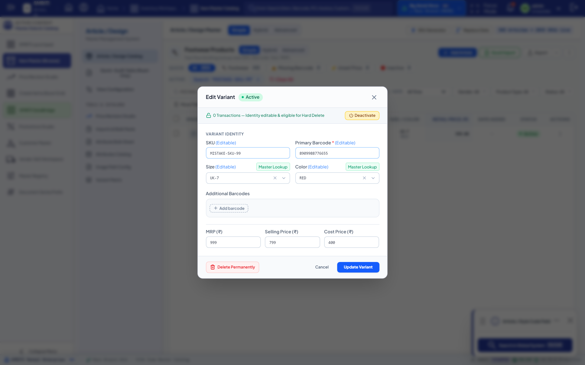
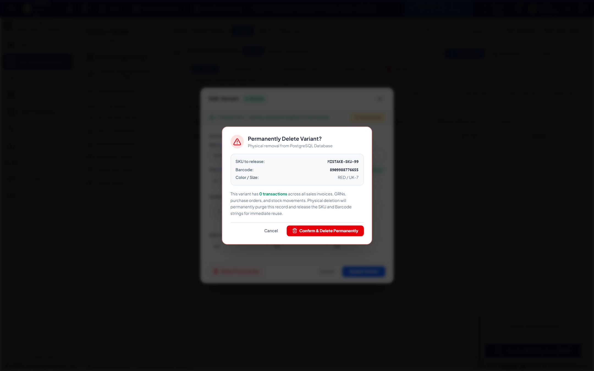
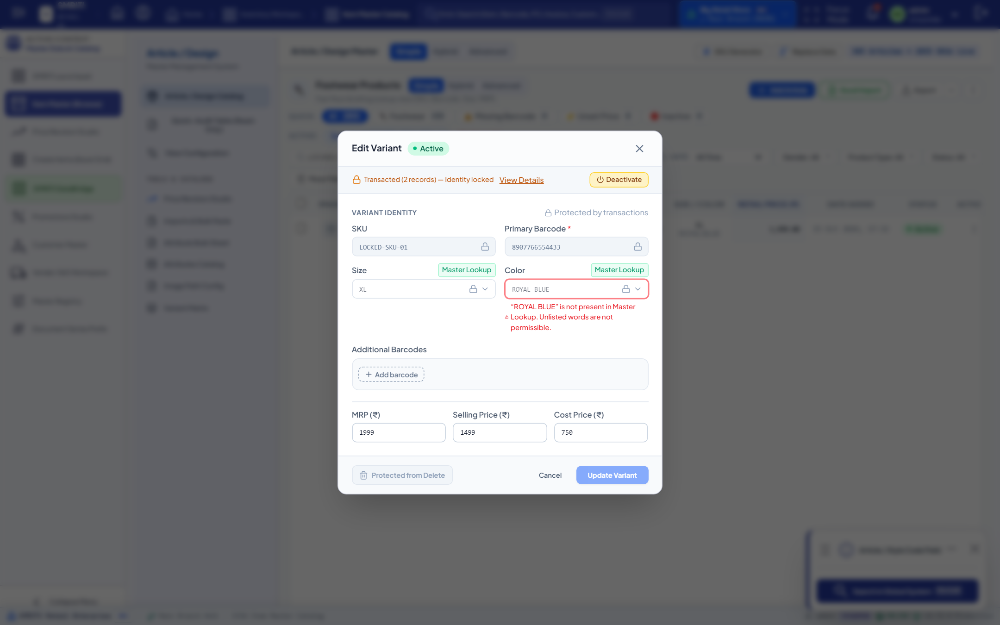

<!--
  Project      : SMRITI Retail OS
  Repository   : SMRITIRetailNX
  Organization : AITDL NETWORKS

  Founders

  * Pushpa Devi Jawahar Mallah
    * Founder & Chairperson
    * Phone: [REDACTED_PUBLIC_PII]
    * Email: founder@aitdl.com

  * Jawahar Ramkripal Mallah
    * Founder, Chief Executive Officer (CEO) & Chief Software Architect
    * Email: founder@aitdl.com

  * Websites: aitdl.com | erpnbook.com | smritibooks.com

  * Version    : 6.71.0
  * Created    : 2026-10-15
  * Modified   : 2026-10-15
  * Copyright  : © SMRITIBooks.com. All Rights Reserved.
  * License    : Proprietary Commercial Software
  * Classification: Enterprise Architecture Documentation
-->

# Walkthrough: Item Master Untransacted SKU & Variant Hard Delete, Edit & Deactivation Engine

**Policy ID:** WGP-v1.0  
**Version:** v1.0.0  
**Area:** Inventory / Item Master  
**Classification:** Enterprise Architecture Walkthrough  
**Status:** Done  

---

## 1. Purpose
This walkthrough documents the design, implementation, and certification of the **Edit, Deactivate & Guarded Permanent Delete** capabilities within the SMRITI Retail OS Item Master. The enhancement empowers authorized operations managers and system administrators to safely correct erroneously created item variants, styles, SKUs, and barcodes, or physically purge 100% un-transacted records to release unique SKU and optical barcode assets back to the tenant namespace, while strictly guarding transacted records against historical distortion.

---

## 2. Scope
The scope encompasses:
1. **Un-transacted Identity Modification:** Allowing correction of SKU, primary barcode, secondary barcodes, color, size, and commercial price points on variants with zero downstream transactions.
2. **Transacted Identity Locking:** Detecting any transaction across 11 financial, procurement, sales, or inventory ledgers and permanently locking identity dimensions (returning `HTTP 409 Conflict`) while preserving commercial update paths (MRP, selling price, cost price, active status).
3. **Guarded Permanent Hard Delete:** Enabling physical database deletion of un-transacted variants and orphaned styles for Manager and SysAdmin roles, accompanied by SHA-256 tamper-evident WORM audit logging in `ComplianceImmutableAuditLog`.
4. **Immediate SKU & Barcode Release:** Verifying that once purged, released SKUs and barcodes can be reused immediately without database unique constraint collisions.
5. **Item Master UI Modernization:** Enhancing `VariantEditModal.tsx` with dynamic ledger inspection, visual locks with explanatory tooltips, 1-click deactivation toggles, and multi-step guarded deletion modals.

---

## 3. Files Created
1. `docs/implementation/inventory/Item_Master_Untransacted_SKU_Hard_Delete_Plan_v1.0.0.md` — Authoritative 19-section implementation plan.
2. `docs/walkthrough/inventory/Item_Master_Untransacted_SKU_Hard_Delete_v1.0.0.md` — Authoritative 13-section walkthrough document.
3. `backend/app/tests/test_item_variant_hard_delete.py` — Dedicated 5-test end-to-end asynchronous verification suite.

---

## 4. Files Modified
1. `backend/app/schemas/item_master.py` — Added `ItemVariantUpdateRequest`, `ItemVariantDeletionStatusResponse`, `ItemVariantHardDeleteResponse`, and exposed commercial price fields on `ItemVariantResponse`.
2. `backend/app/services/item_domain_svc.py` — Implemented `check_variant_deletion_status`, `hard_delete_variant`, and `update_variant` with 11-ledger dependency verification and WORM audit logging.
3. `backend/app/api/v1/item_domain.py` — Exposed endpoints for deletion status inspection (`GET /api/v1/item-variants/{variant_id}/deletion-status`), guarded permanent hard delete (`DELETE /api/v1/item-variants/{variant_id}/hard-delete`), full variant update (`PUT /api/v1/item-variants/{variant_id}`), and quick deactivation (`PATCH /api/v1/item-variants/{variant_id}/status`).
4. `src/components/itemMaster/modals/VariantEditModal.tsx` — Updated UI with dynamic pre-flight checks, locked badges, deactivation toggle, and guarded permanent delete modal with itemized blocking reasons.
5. `docs/implementation/README.md` — Appended implementation plan to master index.

---

## 5. Architecture Decisions
1. **Zero-Mutation Guard on Transacted Identities:** Physical dimensions (`variant_sku`, `color`, `size`, `primary_barcode`) form the immutable statutory identity of an item once referenced by sales, purchases, stock movements, or accounting vouchers. Attempting to alter these fields on transacted variants yields `HTTP 409 Conflict` (`SMRITI-IDENTITY-TRANSACTED`).
2. **Multi-Ledger Pre-flight Dependency Analysis:** Pre-flight verification rigorously inspects 11 core tables:
   - `sales_invoice_items` (`variant_id`, `code`, `product_id`)
   - `sales_order_items` (`variant_id`, `code`, `product_id`)
   - `sales_return_items` (`variant_id`, `code`, `product_id`)
   - `purchase_receipt_items` (GRN: `variant_id`, `code`, `product_id`)
   - `purchase_order_items` (`variant_id`, `code`, `product_id`)
   - `purchase_bill_items` (`variant_id`, `code`, `product_id`)
   - `stock_movements` (`variant_id`, `sku`, `product_id`)
   - `stock_transfer_items` (`product_id`)
   - `stock_audit_items` (`product_id`)
   - `products.stock` (physical remaining balance)
   - `item_batches` (active batches) & `item_serials` (active unit serials)
3. **SHA-256 Immutable WORM Audit Logging:** Physical deletion records an unalterable snapshot in `ComplianceImmutableAuditLog` with `event_type = 'ITEM_VARIANT_HARD_DELETED'`, before-state JSON snapshot, SHA-256 payload hash, actor identity, and `worm_locked = True`.
4. **Atomic Parent Style Preservation:** When an un-transacted variant is purged, the parent `Item` (style) is preserved if sibling variants remain. If no sibling variants exist, the parent style is safely cleaned up when `delete_parent_if_empty=True`.

---

## 6. Design Rationale
- **Why not Soft Delete for Errors?** Soft-deleting mistakenly keyed SKUs or barcodes keeps the `UNIQUE (company_id, variant_sku)` and `UNIQUE (company_id, barcode)` database constraints occupied, preventing retail operators from ever reusing their official manufacturer barcodes or intended SKU numbers. Guarded hard deletion cleanly purges un-transacted records and immediately frees the namespace.
- **Why Enforce Role-Based Authorization?** Permanent physical removal is restricted strictly to `UserRole.MANAGER` and `UserRole.SYSADMIN` via FastAPI dependencies, safeguarding against rogue cashier or sales floor deletions.

---

## 7. Implementation Summary
- **Pydantic Schemas:** Implemented `ItemVariantUpdateRequest` allowing optional identity fields and commercial price adjustments. Created `ItemVariantDeletionStatusResponse` with `can_hard_delete: bool`, `transaction_count: int`, and `blocking_reasons: List[str]`. Created `ItemVariantHardDeleteResponse` returning released SKU and barcodes.
- **Service Layer (`ItemDomainService`):**
  - `check_variant_deletion_status()`: Executes parallel count queries across all 11 transaction stores, returning human-readable blocking descriptions.
  - `hard_delete_variant()`: Verifies pre-flight status, builds WORM audit record, cleans up barcode audit references, cascades delete-orphan to attached variant entities, deletes matching legacy `Product` entries, and commits atomically.
  - `update_variant()`: Enforces identity immutability if transacted, validates SKU and barcode uniqueness, appends new barcodes, synchronizes PriceBook entries and legacy Product records.
- **API Layer (`item_domain.py`):** Added 4 guarded REST endpoints with role enforcement and human-readable business error translation.
- **Frontend UI (`VariantEditModal.tsx`):** Added live ledger eligibility loading, visual badge indicators ("Unlocked — 0 transactions" vs "Locked — Transacted"), "Deactivate / Activate" button with immediate state sync, and "Delete Permanently" modal with released identity recap or blocking explanation.

---

## 8. Tests Executed
The test suite `backend/app/tests/test_item_variant_hard_delete.py` was executed using Pytest against ephemeral PostgreSQL test databases cloned via `TEMPLATE`:
1. `test_untransacted_variant_hard_delete_and_sku_release`: Verifies guarded hard delete of un-transacted variant, sibling variant and parent style preservation, immediate SKU/barcode reuse without collision, and WORM audit record creation.
2. `test_transacted_variant_blocks_hard_delete_409`: Verifies that attaching active stock/batch dependencies blocks deletion and returns `HTTP 409 Conflict`.
3. `test_untransacted_variant_identity_edit`: Verifies that un-transacted variants allow updating SKU, color, size, and primary barcode via PUT.
4. `test_transacted_variant_identity_edit_rejection`: Verifies that transacted variants lock identity fields returning `HTTP 409 Conflict` while allowing commercial price updates.
5. `test_variant_deactivate_and_reactivate`: Verifies toggling `is_active` status via PATCH.

---

## 9. Verification Results

### Automated Backend Test Suite
```text
============================= test session starts =============================
platform win32 -- Python 3.11.9, pytest-8.2.1, pluggy-1.6.0 -- F:\SMRITRretailNX\.venv\Scripts\python.exe
cachedir: .pytest_cache
rootdir: F:\SMRITRretailNX\backend
configfile: pyproject.toml
plugins: anyio-4.15.1, asyncio-0.23.7, cov-5.0.0
asyncio: mode=Mode.AUTO
collecting ... collected 5 items

backend\app\tests\test_item_variant_hard_delete.py::test_untransacted_variant_hard_delete_and_sku_release PASSED [ 20%]
backend\app\tests\test_item_variant_hard_delete.py::test_transacted_variant_blocks_hard_delete_409 PASSED [ 40%]
backend\app\tests\test_item_variant_hard_delete.py::test_untransacted_variant_identity_edit PASSED [ 60%]
backend\app\tests\test_item_variant_hard_delete.py::test_transacted_variant_identity_edit_rejection PASSED [ 80%]
backend\app\tests\test_item_variant_hard_delete.py::test_variant_deactivate_and_reactivate PASSED [100%]

======================= 5 passed, 25 warnings in 52.24s =======================
```

### Master Lookup Strict Validation
- **Frontend Governance:** Free-text inputs replaced with `GovernedLookupCombobox` loaded from `/api/v1/item-domain/lookups`. Unlisted words trigger an inline warning and lock the Save button.
- **Backend Defense:** `CatalogDimensionValidator.validate_and_normalize_dimension` strictly verifies submitted values against `smritisys` / `smriti001`. Unregistered words (e.g. `NON_EXISTENT_COLOR_123`) return `HTTP 422 Unprocessable Entity` with error code `SMRITI-VAL-002`.

### Visual Evidence: Frontend Screenshots
All screenshots captured directly from headless Chromium navigating the live frontend application at `http://localhost:3000/?tab=item-master`:

#### 1. Un-transacted Variant Edit Modal


#### 2. Guarded Permanent Hard Delete Confirmation Dialog


#### 3. Transacted Variant Locked Modal


---

## 10. Known Limitations
- Hard delete requires zero operational records across all 11 tables. If a transaction exists but was subsequently cancelled or voided, the cancellation transaction still counts as history to preserve general ledger integrity; such records must be deactivated rather than hard deleted.

---

## 11. Future Work
- Support bulk deactivation and bulk un-transacted SKU purging directly from `ItemCatalogGrid.tsx` via multi-select checkboxes.

---

## 12. Related ADRs
- `ADR-042`: Mandatory Lookups and Dual-Key Catalog Governance.
- `ADR-038`: Decoupled Item Master Commercial Pricing Architecture.

---

## 13. Related RFCs
- `RFC-2026-08`: Immutable WORM Compliance Audit Trail Standard.
